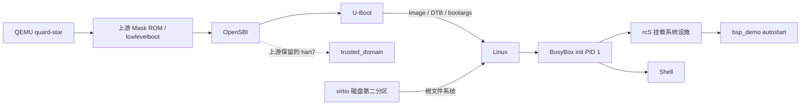

# 基于 Quard Star / QEMU RISC-V 的嵌入式 Linux 构建与启动调试

基于 [Quard Star](https://github.com/QQxiaoming/quard_star_tutorial) 上游板级支持，精简为系统启动、内核参数、自编 C 程序和开机自启动四项成果。上游固定提交：`083d2dd8337adc0c7fd0522e1d16e075b9f11365`。

**已完成任务书 v3 的 S0、T1—T4 核心范围。基线与定制系统均已实际启动到 Shell，并完成参数、自启动和手动运行验收。**

## 当前云环境

- 宿主：Debian 13 / x86_64，5 CPU，约 33 GiB 内存；默认最多 `JOBS=4`。
- 工程：`/workspace/-QEMU-RISC-V-Linux-`，使用已有独立任务 checkout，不需要另建 worktree。
- 上游源码归档：`/workspace/quard-star-upstream`，不包含 Git 元数据。
- 新增工具依赖：`/workspace/riscv-env`，均在工作区安装，无需系统 root。
- 编译产物：本工程 `output/`，不提交上游源码及生成的大文件。
- 现有其他工程不在脚本操作范围内。

## 版本与来源

| 组件 | 版本 / 来源 | 处理 |
| --- | --- | --- |
| QEMU | 上游定制 8.0.0 | 源码构建，确认包含 quard-star |
| Mask ROM / lowlevelboot / trusted_domain | 同一上游固定提交 | 源码构建，复用原设计 |
| OpenSBI | 上游 1.2 | 源码构建，复用 quard_star / Domain 配置 |
| U-Boot | 上游 2023.04 | qemu-quard-star_defconfig，源码构建 |
| Linux | 上游 6.1.11 | GCC 11.1 源码构建，关闭本范围不使用的 ftrace / GCC 插件 |
| BusyBox | 上游 1.33.2 | quard_star_defconfig，关闭不使用且与新 UAPI 不兼容的 tc |
| Linux 用户态交叉编译器 | Debian GCC 14.2 / binutils 2.44 | 复用云环境中验证过的工作区工具链 |
| 内核 / 裸机交叉编译器 | riscv-gnu-toolchain 2021.08.07 / GCC 11.1 / binutils 2.36.1 | 分别使用官方 Linux 和 ELF 预编译工具链 |
| 裸机 C 库 | newlib 4.1.0 | 自行编译 medany 库，适配高地址固件 |
| 目标 Linux C 库 | Debian RISC-V glibc 2.41 | 随交叉工具链配套，放入 rootfs/lib |

源码与依赖均保留 TLS、签名或固定 SHA256 校验。详细问题见 [构建适配记录](docs/构建适配记录.md)。

## 构建

已准备的当前实例可以直接构建。新环境先恢复已发布的工具链快照，然后运行：

```bash
cd /workspace/-QEMU-RISC-V-Linux-
./scripts/prepare.sh
./scripts/build-all.sh
```

`prepare.sh` 会刷新工作区依赖、核验和准备固定源码，依赖当前云环境已有的 `/workspace/riscv-env/install.sh`；它不是任意发行版上的通用安装器。`build-all.sh` 按 newlib → QEMU → 固件/DTB → U-Boot → Linux → BusyBox → 镜像的顺序构建，复用有效中间产物。完整内核初次编译需要时间，查看 `output/logs/`，不要因暂时没有终端输出反复启动重复构建。

各组件也可以单独运行 `scripts/build-*.sh`。日志捕获示例：

```bash
./scripts/build-kernel.sh > output/logs/kernel.log 2>&1
```

## 启动（宿主执行）

```bash
cd /workspace/-QEMU-RISC-V-Linux-
./scripts/run.sh
```

无图形界面、无网络服务。PATH 中的通用 QEMU 不是本项目运行入口；脚本使用 `output/build/qemu/qemu-system-riscv64`。使用自定义 quard-star、1 GiB 内存、8 个虚拟 hart、TCG、上游 SD 启动、virtio 块磁盘。上游 Domain 为 trusted_domain 保留 hart7，Linux 使用剩余 7 个 hart；这里没有新增 Domain 设计。

若 BusyBox 提示 `Please press Enter to activate this console`，按回车进入 Shell。退出目标可执行 `poweroff`；不要直接关闭仍在写磁盘的宿主进程。保留日志可以使用：

```bash
set -o pipefail
./scripts/run.sh 2>&1 | tee evidence/boot-session.log
```

## 确认（目标 Shell 执行）

```sh
uname -m
uname -r
cat /proc/cmdline
cat /proc/sys/kernel/printk
/usr/bin/bsp_demo manual
```

预期架构是 riscv64，内核是 6.1.11。自启动必须在未手动运行程序前，就在启动日志看到 `[BSP_DEMO] started mode=autostart`。最终实际验收记录见下方状态与 evidence；宿主 uname 或 qemu-user 的 uname 不作整机内核启动证据。

## 两项个人定制

1. `configs/boot.baseline.cmd` 与 `configs/boot.cmd` 的差别是 `loglevel=7` → `loglevel=4`。U-Boot 使用 mkimage 生成的 boot.scr，从 FAT32 分区加载 Image 与 DTB，再传入 bootargs。保留 root=/dev/vda2 和 console=ttyS0。
2. `app/bsp_demo.c` 输出启动方式、系统架构、内核版本和 uptime。安装到 `/usr/bin/bsp_demo`，由 `rootfs/etc/inittab` 的 sysinit 项调用 rcS；rcS 挂载 proc 后调用程序。应用读取 /proc/uptime，输出后退出。

更换启动脚本后只需重做镜像，无需重编内核：

```bash
# 请先在目标 poweroff，确保模拟器已退出
./scripts/make-images.sh baseline   # 基线 loglevel=7
./scripts/run.sh
# 关机后
./scripts/make-images.sh custom     # 定制 loglevel=4
./scripts/run.sh
```

`make-images.sh` 重建磁盘，目标系统内的临时改动不会保留。每个目标版本的最终串口输出应单独保存。

## 镜像与启动链路

固件组件按上游约定偏移组装进 32 MiB Flash/SD 镜像，脚本检查每个组件是否越界。virtio 磁盘共 353 MiB，含从第 2048 扇区开始的 96 MiB FAT32 启动分区和从第 198656 扇区开始的 256 MiB ext4 根分区；制作全程只访问普通文件，不用 loop 或 mount。



OpenSBI 的上游 Domain 同时负责 trusted_domain 的独立交接；它不是需要本人实现的学习任务。

## 验收状态

2026-11-04 在当前云实例完成两轮真实启动与正常关机，结果如下：

| 检查 | 基线 | 定制 |
| --- | --- | --- |
| 设备树 model | riscv-quard-star,qemu | riscv-quard-star,qemu |
| 目标架构 / 内核 | riscv64 / 6.1.11 | riscv64 / 6.1.11 |
| /proc/cmdline | loglevel=7 | loglevel=4 |
| /proc/sys/kernel/printk | 7 4 1 7 | 4 4 1 7 |
| bsp_demo 自启动 / 手动运行 | 均通过 | 均通过 |
| PID 1 / Shell | init / 可交互 | init / 可交互 |

完整日志：[基线](evidence/boot-baseline.log)、[定制](evidence/boot-custom.log)。简要摘录见 [验收结果](docs/验收结果.md)。源码固定信息、实际配置、ELF 依赖和产物 SHA256 均在 evidence/。

`prepare.sh` 已重复执行通过，组件构建命令和启动入口已在当前实例实际执行。未另行验证清空所有输出后从头重建，也未验证发布后的新任务恢复。

历史失败日志 `boot-ftrace-failure.log` 和 `boot-network-stall.log` 保留，最终内核采用 GCC 11.1 / binutils 2.36.1。上游音频 ASoC DAI 探测仍失败，音频不在本次范围；网络连接与图形功能未验收。不将这些功能写为完成。

## 对照第一个项目新增的内容

RK3576 项目已经覆盖设备树、platform/input、I2C、字符设备与 V4L2；本项目不再重复添加同类教学驱动。查阅官方目录后，仅新增 **扩展 4 的 QEMU gdbstub 启动调试**：

- `scripts/run-debug.sh`：暂停虚拟 CPU，并在宿主 127.0.0.1:1234 提供 GDB 接口。
- `scripts/debug-kernel.sh`：加载与运行内核匹配的 vmlinux，连接 QEMU。
- 已命中 `start_kernel` 和 `run_init_process`，完成源码单步、寄存器、调用栈和 `/sbin/init` 参数检查；detach 后正常进入 Shell。
- 这是 QEMU gdbstub 实验，不宣称完成真实板卡 KGDB/JTAG 调试，也不宣称修复了新的真实驱动故障。

操作、六个知识点及实际记录见 [GDB 启动调试](docs/GDB启动调试.md)，章节取舍见 [扩展取舍](docs/扩展取舍.md)。本次只加这一项，没有凑第二项。v3 原任务书的“不做 GDB”范围依据后续补充请求更新；其他原有删减范围保留。

## 学习材料

建议以以下三份作为主资料，旧的一页卡用于复习：

1. [项目完整流程与学习路线](docs/项目完整流程与学习路线.md)：构建/启动两条主线，分步骤对照操作、产物、知识点和问答编号。
2. [关键代码逐段讲解](docs/关键代码逐段讲解.md)：实际代码摘录与可点击源码位置，优先精读自己的小文件。
3. [项目八股问答：30 题](docs/项目八股问答.md)：必会/理解分级，带本工程证据和常见追问。


- [一页背诵卡](docs/一页背诵卡.md)：先掌握主线。
- [面试速记与十个问答](docs/面试速记.md)：对照实际文件解释。
- [学习顺序](docs/学习顺序.md)：用最少操作掌握项目。
- [关键文件索引](docs/文件索引.md)：源码、生成文件、目标系统分别在哪。
- [任务书评审](docs/任务书评审.md)、[简历与讲述](docs/简历与讲述.md)：范围及表达边界。

上游代码版权归原作者，见上游 LICENSE 及各组件许可证。本仓库不将上游板级支持或驱动标记为个人实现，不包含新驱动、实板 DDR 初始化或性能优化。
