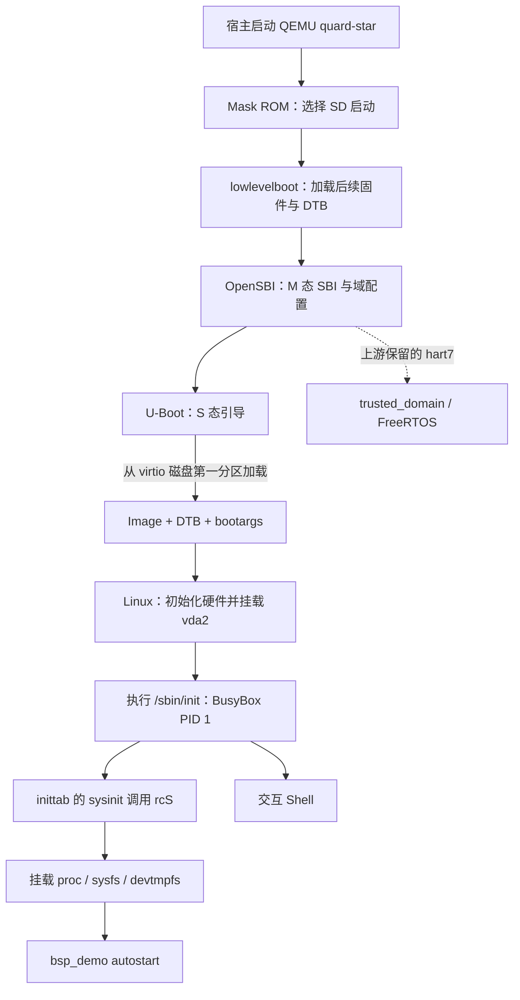

# 项目完整流程与学习路线

这份资料按已经完成并验证的工程编写。先读主线，再看自己的代码，最后练问答和目标操作。它对应第二个项目“基于 Quard Star / QEMU RISC-V 的嵌入式 Linux 构建与启动调试”。第一个 RK3576 项目已有 GPIO/I2C/字符设备/V4L2，本项目不重复扩展这些驱动。

配套资料：[关键代码逐段讲解](关键代码逐段讲解.md)、[项目八股问答](项目八股问答.md)。八股题号 Q01—Q30 与下文各阶段对应。

## 先分清两条顺序

**构建顺序是在宿主准备文件：**

工具与源码 → 裸机 C 库 / 自定义 QEMU → 固件与 DTB → U-Boot → Linux → BusyBox → 应用与 rootfs → 打包镜像。

**启动顺序是虚拟目标执行代码：**



QEMU 是宿主进程，图中的固件、内核和应用是目标代码。“编译 QEMU”与“编译 RISC-V 内核”所用编译目标不同。

## 学习深度

| 等级 | 学到什么程度 | 内容 |
| --- | --- | --- |
| 必会 | 不看答案能讲清，能找到文件并完成操作 | 启动主线、交叉编译、Image/DTB/rootfs、bootargs、自启动、自己的 C 程序、实际 GDB 命令 |
| 理解 | 知道职责、能解释项目为什么需要它 | M/S/U、OpenSBI、virtio、动态解释器与库、镜像分区、构建配置 |
| 暂不深挖 | 能说“复用上游”，指出入口即可 | QEMU 设备模型、多级启动汇编、链接脚本、OpenSBI Domain 实现、FreeRTOS 端口、完整内核初始化 |

不用背所有寄存器值、固件偏移、上游函数实现或所有编译选项。需要理解的是它们各自解决什么问题。

## 第 0 步：看清工程位置和自己的工作

| 位置 | 实际含义 |
| --- | --- |
| `/workspace/-QEMU-RISC-V-Linux-` | 本项目仓库：脚本、配置、应用和学习材料 |
| `/workspace/quard-star-upstream` | 固定提交的上游源码归档，没有 Git 元数据 |
| `/workspace/riscv-env` | 工作区工具链和安装的依赖 |
| 本仓库 `output/build` | 编译中间文件；不是目标系统的 / |
| 本仓库 `output/rootfs` | 在宿主上暂存的目标根文件系统目录 |
| 本仓库 `output/images` | 内核、DTB、固件和可启动磁盘等产物 |
| 本仓库 `evidence` | 实际目标启动、参数、程序和调试记录 |

**自己的实现/集成**：构建与免 root 镜像制作脚本；启动参数定制；`bsp_demo.c`；inittab/rcS；GDB 启动入口与实测记录。

**复用上游**：虚拟板卡、底层固件、OpenSBI/Domain、U-Boot 板级支持、Linux 驱动及基础配置、FreeRTOS 依赖。

你要能用这两句话介绍：“我基于开源板级支持做系统构建与定制；不是从零编写设备模型和移植 BSP。”对应 Q30。

## 第 1 步：固定源码、准备工具链

**做了什么**：固定上游提交 `083d2dd8337adc0c7fd0522e1d16e075b9f11365`，下载校验源码与工具链；将依赖解包到工作区，适配没有管理员权限的宿主。

**看哪里**：[prepare.sh](../scripts/prepare.sh)、[env.sh](../scripts/env.sh)、[sources.json](../evidence/sources.json)。

| 用途 | 本工程实际使用 |
| --- | --- |
| QEMU 本身 | 宿主 x86_64 编译器；输出在宿主执行的模拟器 |
| Linux 内核 | 官方 Linux GCC 11.1 / binutils 2.36.1 |
| Mask ROM / lowlevelboot / trusted_domain | 裸机 GCC 11.1，链接重新构建的 medany newlib |
| OpenSBI / U-Boot | 工作区 Linux GCC 14.2 |
| BusyBox / bsp_demo | 工作区 Linux GCC 14.2，配套 RISC-V glibc 2.41 |

不需要背整张版本表，但要知道本工程确实没有对所有组件强行使用一套工具链。最终内核换到 GCC 11，是经过实际启动兼容性验证后的选择。

**重点知识**：宿主/目标、交叉编译、ABI、sysroot、裸机库与 Linux 用户态库。

**掌握标准**：能回答“编译器在哪运行，输出给谁运行”；能解释 ARCH 与 CROSS_COMPILE。对应 Q01—Q03、Q29。

## 第 2 步：构建支持 Quard Star 的 QEMU

**做了什么**：从上游定制 QEMU 8.0 源码构建 `riscv64-softmmu`，关闭本次不需要的图形前端，确认 `-machine help` 包含 `quard-star`。

**看哪里**：[build-qemu.sh](../scripts/build-qemu.sh)；上游 `qemu-8.0.0/hw/riscv/quard_star.c` 只需知道它是板卡入口。

**产物**：`output/build/qemu/qemu-system-riscv64`。

**重点知识**：QEMU 模拟 CPU 和外设，TCG 用软件执行目标指令；它不需要目标机内核先运行。发行版的通用 QEMU 不必然包含自定义板卡。

**掌握标准**：说清“为什么不直接使用 PATH 中的通用 qemu-system-riscv64”；知道 -M、-m、-smp、-accel、-serial 的用途。对应 Q04、Q05。

## 第 3 步：准备 C 库和早期启动固件

**做了什么**：源码构建 Mask ROM、lowlevelboot、trusted_domain；为高地址固件重建 medany newlib，解决原预编译库的地址模型不匹配。

**看哪里**：[build-newlib.sh](../scripts/build-newlib.sh)、[baremetal-gcc.sh](../scripts/baremetal-gcc.sh)、[build-firmware.sh](../scripts/build-firmware.sh)。

上游只看两个函数：

- `mask_rom/main.c: main()`：本次选择 SD，从 SD 固件镜像读 lowlevelboot，跳转执行。
- `lowlevelboot/main.c: sd_boot()`：按约定偏移加载 OpenSBI、两份 DTB、trusted_domain 和 U-Boot。

**容易混淆**：启动固件来自 `sd.img`；Linux 的启动文件和根文件系统来自另一个 virtio `disk.img`。它们不是同一张“SD 卡根文件系统”。

**重点知识**：前一级加载后一级、存储偏移与 RAM 地址不是一回事；newlib 适用于裸机环境，glibc 面向 Linux 用户态。

**掌握标准**：知道谁加载 OpenSBI/U-Boot。medlow/medany 只需理解“库与固件的地址模型必须匹配”，暂不推导重定位。对应 Q03、Q06。

## 第 4 步：OpenSBI 与设备树

**做了什么**：使用上游 quard_star 平台构建 OpenSBI 1.2；由 DTS 预处理并用 dtc 构建 DTB，复用上游 Domain 配置。

**看哪里**：[build-firmware.sh](../scripts/build-firmware.sh)；上游 `dts/quard_star_sbi.dts`、`dts/quard_star_uboot.dts`、`opensbi-1.2/platform/quard_star/platform.c`。

**产物**：`fw_jump.bin`、`quard_star_sbi.dtb`、`quard_star_uboot.dtb`。

**重点知识**：OpenSBI 在 M 态提供 SBI 接口；本工程 U-Boot/Linux 在 S 态，应用在 U 态。DTB 是硬件描述数据，不是驱动可执行代码。上游将 hart7 留给 trusted_domain，Linux 使用剩余 7 个 hart。

**掌握标准**：讲清 OpenSBI 与 U-Boot 的职责差异，以及 DTS → DTB。知道当前 Linux 所用 DTB 由本项目固件脚本单独构建，不是本次 `make Image` 自动生成。对应 Q07—Q09。

不要求设计 Domain；保留 FreeRTOS 基线依赖不等于本人完成了 FreeRTOS 移植。

## 第 5 步：构建 U-Boot，确定引导入口

**做了什么**：使用上游 `qemu-quard-star_defconfig` 构建 U-Boot。适配独立输出目录中 Logo 的相对路径，保留板级支持。其 Distro Boot 扫描 virtio 第一分区并找到 `/boot.scr`。

**看哪里**：[build-uboot.sh](../scripts/build-uboot.sh)、[boot.cmd](../configs/boot.cmd)；上游 `u-boot-2023.04/include/configs/qemu-quard-star.h` 中 BOOT_TARGET_DEVICES 和地址变量。

**产物**：`u-boot.bin`、宿主工具 `output/build/uboot/tools/mkimage`。

重点读这五行：

```sh
echo Quard Star BSP: loading kernel and device tree from virtio disk
load virtio 0:1 ${fdt_addr_r} /quard_star.dtb
load virtio 0:1 ${kernel_addr_r} /Image
setenv bootargs 'root=/dev/vda2 rw console=ttyS0 earlycon=sbi loglevel=4'
booti ${kernel_addr_r} - ${fdt_addr_r}
```

它是 **U-Boot 脚本**，不能当作 Linux Shell 脚本运行。`0:1` 表示设备 0 的分区 1；`${..._addr_r}` 是 RAM 加载地址；booti 的 `-` 表示不传 initrd，不代表不需要根文件系统。

**掌握标准**：逐行解释；区分 bootcmd 和 bootargs；知道 boot.cmd 需用 mkimage 打包成 boot.scr。对应 Q10—Q12。

## 第 6 步：构建 Linux

**做了什么**：加载上游 quard_star_defconfig，关闭本次不使用的 FTRACE/GCC_PLUGINS，使用验证通过的 Linux GCC 11.1 构建 Image，保留实际配置及带符号 vmlinux。

**看哪里**：[build-kernel.sh](../scripts/build-kernel.sh)、[实际 linux.config](../evidence/linux.config)。

**产物**：`output/images/Image`、`output/build/linux/vmlinux`、`output/images/linux.config`。

**重点知识**：

- defconfig 是默认配置入口，`.config` 是实际展开后的配置；`olddefconfig` 按已有设置补全依赖与默认值。
- `CONFIG_*=y/m/n` 分别表示内建、模块、不构建。
- 本次没有 initramfs，根磁盘所需 virtio 块设备、ext4 等必须在挂根所需阶段可用，不能只把驱动模块放进尚未挂载的根文件系统再期待它解决挂根问题。
- Image 用于启动；vmlinux 供符号/源码调试。调试信息会使 vmlinux 很大，不等于引导 Image 同样大。

**掌握标准**：能解释四个构建参数 ARCH、CROSS_COMPILE、O、-j；能区分配置和产物。对应 Q02、Q13—Q15。

## 第 7 步：构建 BusyBox，形成用户空间骨架

**做了什么**：使用上游 BusyBox 1.33.2 配置构建并安装到暂存 rootfs；关闭与新版 UAPI 不兼容且本项目不使用的 tc applet。

**看哪里**：[build-busybox.sh](../scripts/build-busybox.sh)、`output/rootfs/bin/busybox` 及其命令链接。

**重点知识**：Linux 内核不会自带完整 Shell 与命令行工具。BusyBox 把 init、sh、mount、cat、uname 等许多 applet 集中在一个可执行文件里，通过链接名称或参数分派。

| 目标路径 | 本项目作用 |
| --- | --- |
| /sbin/init | BusyBox init，内核启动的 PID 1 用户态程序 |
| /bin/sh | 交互和初始化脚本使用的 Shell |
| /etc | inittab、rcS、profile 等配置 |
| /lib | 目标动态解释器与 glibc/libm/libresolv |
| /dev | 设备节点，由 devtmpfs 提供 |
| /proc | 内核导出的进程与系统信息，如 uptime/cmdline |
| /sys | 设备模型等内核接口 |
| /usr/bin/bsp_demo | 本项目应用 |

**掌握标准**：解释“内核启动了为什么还需要 rootfs 和 BusyBox”；知道 /proc 不是打包进去的一份静态日志。对应 Q16、Q17。

## 第 8 步：编写并部署 bsp_demo

**做了什么**：编写一次性 C 程序，输出调用方式、架构、内核版本和启动时长；交叉编译并安装进目标文件系统，配齐目标运行库。

**看哪里**：[bsp_demo.c](../app/bsp_demo.c)、[make-images.sh](../scripts/make-images.sh)、[ELF 记录](../evidence/bsp_demo.elf.txt)。逐段解释见配套代码资料。

核心调用：

```c
uname(&info);                         /* 正在运行的系统的信息 */
FILE *fp = fopen("/proc/uptime", "r");
fscanf(fp, "%lf", &uptime);           /* 第一个字段，单位秒 */
```

真实代码还检查参数、系统调用和文件读取错误，并关闭文件。它不采集传感器、不常驻、不创建线程。

**重点知识**：目标架构、ELF 解释器、动态库、文件权限、返回值；uname 的结果来自运行时内核，不是编译机器。

**掌握标准**：自己能重新编译这份 C 程序，解释 main 中每段逻辑，并说明为什么不能复制 x86 的 libc 到 RISC-V rootfs。对应 Q18、Q19、Q20。

## 第 9 步：实现开机自启动

**做了什么**：用 BusyBox init 读取 inittab，通过 sysinit 执行 rcS；先挂载 proc 等系统设施，再调用程序。

**看哪里**：[inittab](../rootfs/etc/inittab)、[rcS](../rootfs/etc/init.d/rcS)、[初始化差异](../evidence/rcS.diff)。

```text
::sysinit:/etc/init.d/rcS
console::askfirst:-/bin/sh
```

```sh
mount -t proc proc /proc || exit 1
# ……挂载其他系统设施……
/usr/bin/bsp_demo autostart || printf '[INIT] bsp_demo FAILED\n'
```

`autostart` 是调用者给程序的参数，不是程序自己检测出来的启动方式。证明自启动的是：尚未输入手动运行命令时，串口已经出现这段程序输出。

**掌握标准**：完整复述“内核 → PID 1 → inittab → rcS → 程序”；指出先挂载 proc 的原因。对应 Q21、Q22。

## 第 10 步：制作镜像

**做了什么**：先制作文件系统内容，再把它们作为分区组装成磁盘；另按上游约定布局组装早期固件。全程只处理普通文件，无需宿主 mount/loop 权限。

**看哪里**：[make-images.sh](../scripts/make-images.sh)、[pack-images.py](../scripts/pack-images.py)。

| 文件/分区 | 内容和用途 |
| --- | --- |
| 32 MiB 的 sd.img 等固件镜像 | lowlevelboot、OpenSBI/DTB、trusted_domain、U-Boot 等，按约定偏移放置 |
| disk.img 第一分区：96 MiB FAT32 | Image、quard_star.dtb、boot.scr，供 U-Boot 读取 |
| disk.img 第二分区：256 MiB ext4 | BusyBox、init、库、配置、应用，供 Linux 挂成根目录 |

关键操作：mkfs.fat 格式化启动分区文件；mcopy 放入启动文件；mke2fs -d 将暂存目录内容写入 ext4；Python 写 MBR 分区表并复制分区镜像。

**掌握标准**：区分“目录、文件系统、分区、磁盘镜像、内核镜像”；理解 vda2 指第二分区。不要背每个扇区数字或手写 MBR 字节布局。对应 Q23、Q24。

## 第 11 步：启动、参数定制与复验

**宿主执行**：

```bash
cd /workspace/-QEMU-RISC-V-Linux-
./scripts/run.sh
```

**看哪里**：[run.sh](../scripts/run.sh)、[参数差异](../evidence/bootargs.diff)。

**目标 Shell 执行**：

```sh
uname -m
uname -r
cat /proc/cmdline
cat /proc/sys/kernel/printk
/usr/bin/bsp_demo manual
ps | head -4
```

| 实测项 | 基线 | 定制 |
| --- | --- | --- |
| 架构/内核 | riscv64 / 6.1.11 | riscv64 / 6.1.11 |
| cmdline 中参数 | loglevel=7 | loglevel=4 |
| printk 四个数 | 7 4 1 7 | 4 4 1 7 |
| 程序自启动/手动 | 通过 | 通过 |
| PID 1 | init | init |

**重点知识**：root=/dev/vda2、console=ttyS0；内核接收到什么，以 /proc/cmdline 为准；当前阈值看 /proc/sys/kernel/printk。降低 loglevel 不等于删除内核日志，也不是性能优化证明。

修改后先关机，再在宿主运行 `./scripts/make-images.sh baseline` 或 `custom` 并重启。只改启动脚本或应用时通常无需重编内核；但需更新磁盘镜像。打包脚本会重建磁盘，目标内临时修改不会保留。

**掌握标准**：亲手完成一次参数前后对照，知道为何宿主上改完文件还不等于虚拟目标已更新。对应 Q11、Q12、Q25。

## 第 12 步：用 GDB 验证内核到用户空间的交接

这是查阅官方 ext4 后，依据后续请求添加的唯一调试扩展。

**看哪里**：[run-debug.sh](../scripts/run-debug.sh)、[debug-kernel.sh](../scripts/debug-kernel.sh)、[完整复现说明](GDB启动调试.md)、[实测 GDB 会话](../evidence/gdb-startup.log)。

1. 终端 A 运行 `./scripts/run-debug.sh`，QEMU 通过 -S 暂停，gdbstub 只监听宿主 127.0.0.1:1234。
2. 终端 B 运行 `./scripts/debug-kernel.sh`，加载匹配的 vmlinux 后连接。
3. 输入 `hbreak start_kernel`、`continue`，停在 Linux 的 C 入口。
4. 用 `list`、`bt`、`info registers pc sp` 看源码/调用栈/寄存器；`next` 做一次源码单步；读取 init_task.comm。
5. 输入 `hbreak run_init_process`、`continue`，第二次停住后 `print init_filename` 得到 `/sbin/init`。
6. 删除断点，detach 后回终端 A，系统继续进入 Shell，原有程序自启动和手动运行均通过。

实际 GDB 回溯：

```text
start_kernel → _start_kernel
run_init_process → try_to_run_init_process → kernel_init → handle_exception
```

箭头按 bt 输出“当前函数到调用者”阅读，不要当成从左向右的启动执行顺序。第二个断点证明内核准备执行 `/sbin/init`；随后看到 rcS 和程序输出，证明后续用户空间启动成功。

**掌握标准**：独立复现两个断点；区分 gdbstub 和 KGDB；解释为什么需要匹配的 vmlinux。仅在虚拟环境验证，不写成真板 KGDB/JTAG 经历。对应 Q26—Q28。

## 第 13 步：整理证据与项目讲述

| 要讲的成果 | 用什么证明 |
| --- | --- |
| 构建并进入目标 Shell | boot-baseline.log、boot-custom.log；目标 uname 与 model |
| 参数调整生效 | bootargs.diff；目标 cmdline；printk 阈值前后变化 |
| 程序部署与自启动 | C 源码、rcS；开机 autostart 与手动 manual 输出 |
| 源码级启动调试 | gdb-startup.log；两个断点、源码单步、栈和 init 参数 |
| 版本与可追溯性 | sources.json、实际配置、工具版本、构建脚本 |

日志在 evidence；未通过/未完成的内容保留边界：GCC 14 两次内核启动问题有历史日志，最终采用已验证组合；音频 DAI 探测失败未计为完成；没有新驱动移植、真板调试、性能指标或新设计的 Domain。

## 建议按这个次序学习

**第一遍：把系统讲通。** 阅读本文件，能不看图复述启动链路；先完成 Q01、Q04、Q06—Q12、Q16、Q21。

**第二遍：把自己的代码读通。** 对照关键代码资料，优先读 boot.cmd → bsp_demo.c → inittab/rcS → make-images.sh → run-debug/debug-kernel。自己修改前先确认虚拟机已关机。

**第三遍：把操作做通。** 普通启动；查看架构/版本/参数；手动运行程序；关机后做参数对照；最后复现 GDB 两个断点。

**第四遍：练面试追问。** 用问答资料自测，每题回答时加“本工程对应哪个文件，我看到了什么实际结果”。看不懂的上游实现不强背，也不把文档中的复用工作说成从零开发。
